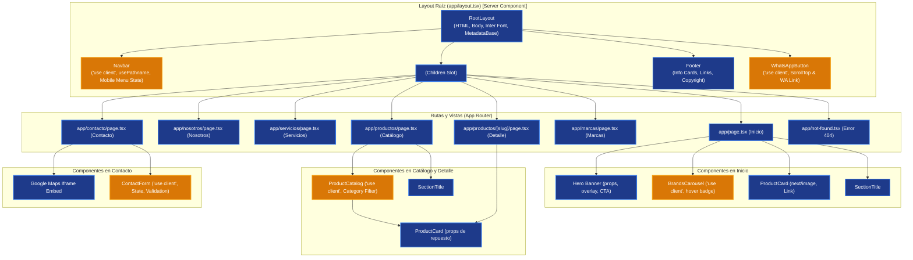

# IKOMI PERÚ S.R.L. — Sitio Web Corporativo con Next.js (App Router)

Proyecto desarrollado para la **Evaluación N° 03** del curso de **Desarrollo de Aplicaciones Web Avanzado: FullStack**.  
Replica interactiva, optimizada y responsiva del sitio web corporativo de **IKOMI PERÚ S.R.L.** ([ikomiperu.com](https://www.ikomiperu.com)), importadora y comercializadora de repuestos para camiones y buses de marcas asiáticas (Hyundai, Kia, Mitsubishi, Hino, Isuzu, Nissan).

---

## 🛠️ Tecnologías y Configuración

* **Framework:** Next.js 14+ (App Router con Server Components y SSG)
* **Lenguaje:** TypeScript 5+ (Tipado estricto para entidades y productos)
* **Estilos:** Tailwind CSS 3.4+ con paleta corporativa personalizada
* **Tipografía:** `next/font/google` (Inter)
* **Optimización de Imágenes:** `next/image` con tamaños y carga diferida
* **Iconografía:** `lucide-react`
* **Linter & Calidad:** ESLint 8 (`next/core-web-vitals`)

---

## 🚀 Instalación y Ejecución

Siga los siguientes pasos en la terminal:

```bash
# 1. Clonar el repositorio
git clone https://github.com/Jonel211/replica-ikomiperu.git
cd replica-ikomiperu

# 2. Instalar dependencias
npm install

# 3. Iniciar el servidor de desarrollo local (http://localhost:3000)
npm run dev

# 4. Compilar para producción (validación de tipos y generación estática SSG)
npm run build

# 5. Iniciar el servidor de producción
npm run start

# 6. Validar reglas de estilo y buenas prácticas
npm run lint
```

---

## 🌳 Árbol de Componentes (Server Components vs Client Components)

La arquitectura sigue el principio de Next.js App Router: mantener la mayor parte del árbol como **Server Components (RSC)** para máxima velocidad y SEO, delegando a **Client Components** únicamente las partes interactivas con estado de navegador.



---

## 📂 Estructura del Proyecto

```text
replica-ikomiperu/
├── DECISIONES.md             # Justificaciones técnicas de arquitectura y diseño
├── BITACORA_IA.md            # Registro crítico de 6 interacciones con la IA y errores corregidos
├── README.md                 # Instrucciones, árbol de componentes y guía de despliegue
├── evidencias/               # Capturas de build, experimento Network y vistas responsivas
├── public/                   # Recursos estáticos
├── src/
│   ├── app/
│   │   ├── contacto/         # Ruta /contacto con formulario interactivo y mapa
│   │   ├── marcas/           # Ruta /marcas con tarjetas corporativas de fabricantes
│   │   ├── nosotros/         # Ruta /nosotros con módulos de equipo, almacén y tienda
│   │   ├── productos/        # Ruta /productos con catálogo interactivo
│   │   │   └── [slug]/       # Ruta dinámica /productos/[slug] con SSG y notFound()
│   │   ├── servicios/        # Ruta /servicios con tarjetas oscuras de servicios
│   │   ├── globals.css       # Variables CSS y directivas de Tailwind
│   │   ├── layout.tsx        # Root layout con Navbar, Footer, Inter font y metadata
│   │   ├── not-found.tsx     # Página 404 personalizada con enlaces de rescate
│   │   └── page.tsx          # Página principal / (Hero, destacados, marcas)
│   ├── components/
│   │   ├── BrandsCarousel.tsx# Ticker/carrusel interactivo de marcas
│   │   ├── ContactForm.tsx   # Formulario con validación y estado
│   │   ├── Footer.tsx        # Pie de página réplica con tarjetas flotantes de contacto
│   │   ├── Hero.tsx          # Banner principal de alta resolución con botones CTA
│   │   ├── Navbar.tsx        # Menú superior con usePathname y responsive hamburguesa
│   │   ├── ProductCard.tsx   # Tarjeta de producto con props y optimización next/image
│   │   ├── ProductCatalog.tsx# Catálogo con filtro dinámico por categoría
│   │   ├── SectionTitle.tsx  # Encabezado reutilizable con línea divisoria roja
│   │   └── WhatsAppButton.tsx# Botón flotante de WhatsApp y retorno al inicio (ScrollTop)
│   └── data/
│       ├── marcas.ts         # Datos de marcas de Corea y Japón
│       ├── productos.ts      # Repuestos automotrices tipados con especificaciones y OEM
│       └── servicios.ts      # Datos estructurados de servicios de venta y despacho
├── next.config.mjs           # Configuración de Next.js
├── tailwind.config.ts        # Paleta de colores IKOMI y breakpoints
└── tsconfig.json             # Configuración estricta de TypeScript
```

---

## 🧪 Experimento de Navegación: `<Link>` vs `<a>` (Parte 3.4)

Al reemplazar un componente `<Link href="...">` de `next/link` por una etiqueta nativa `<a href="...">`:
1. **Comportamiento con `<a>`:** El navegador destruye el árbol de React en memoria, descarga nuevamente el documento HTML completo desde el servidor, vuelve a solicitar archivos CSS/JS y re-ejecuta todos los scripts. En la pestaña **Network** de las DevTools se observan múltiples solicitudes de red (status 200/304), tiempo de descarga y un parpadeo visual en pantalla (*full page reload*).
2. **Comportamiento con `<Link>`:** Next.js realiza navegación en el lado del cliente (Client-side Navigation) mediante `pushState`. Solo descarga el payload JSON/RSC de la nueva ruta sin recargar hojas de estilo ni reconstruir componentes persistentes como el `Navbar` o el `Footer`, reduciendo el tráfico de red de cientos de kilobytes a un payload liviano y logrando transiciones instantáneas.

---

## 📱 Pruebas de Diseño Responsivo (Parte 4.4)

El sitio ha sido probado y verificado en tres anchos clave según los criterios de evaluación:
1. **Móvil (375 px):** Menú hamburguesa desplegable accesible, tarjetas de producto en 1 columna, formulario apilado verticalmente y botones táctiles con área mínima de 44px.
2. **Tablet (768 px):** Rejilla a 2 columnas para productos, tarjetas de información en pie de página agrupadas ordenadamente.
3. **Escritorio (1280 px):** Barra de navegación horizontal completa con iconos, rejilla a 3 columnas para productos y marcas, visualización a doble columna de mapa y formulario en `/contacto`.

---

## 👨‍💻 Autor

* **Jonel Aron Villanueva**  
* Estudiante de Desarrollo de Aplicaciones Web Avanzado (Tecsup)
