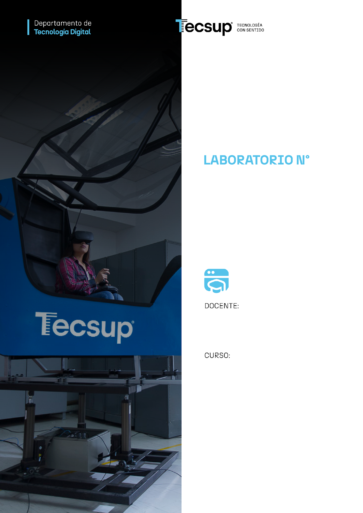
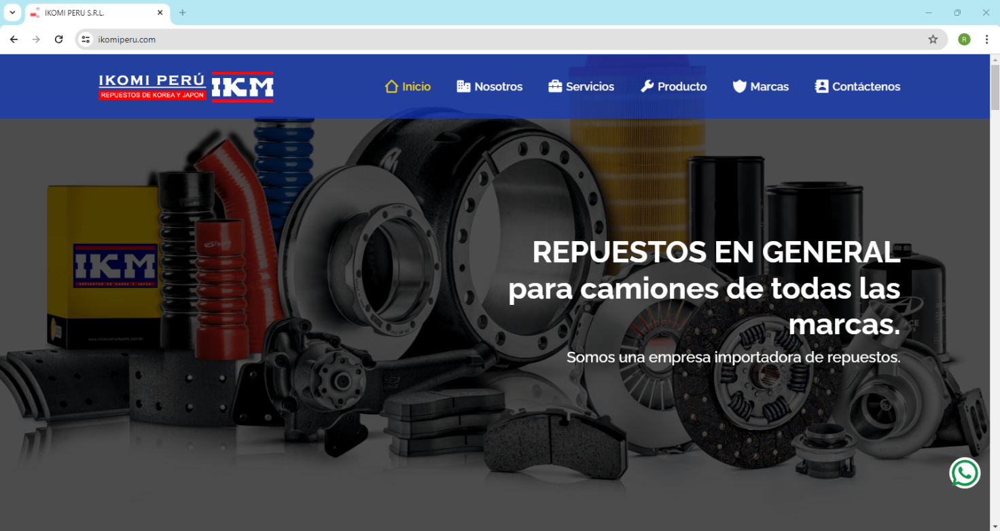
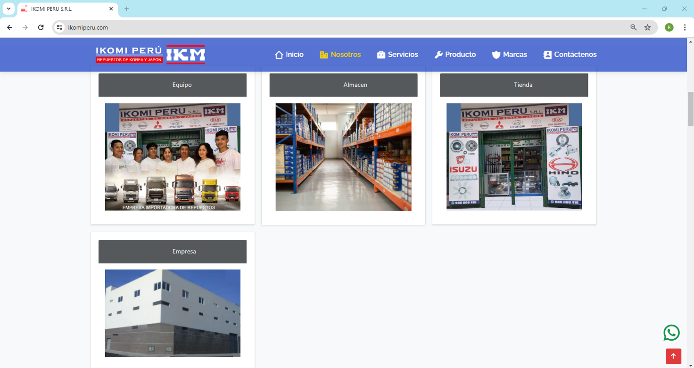
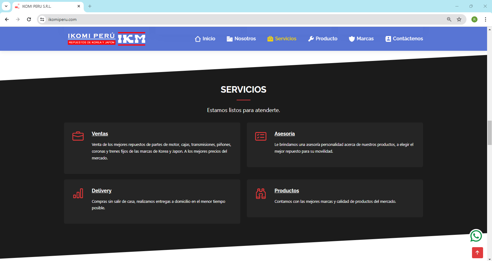
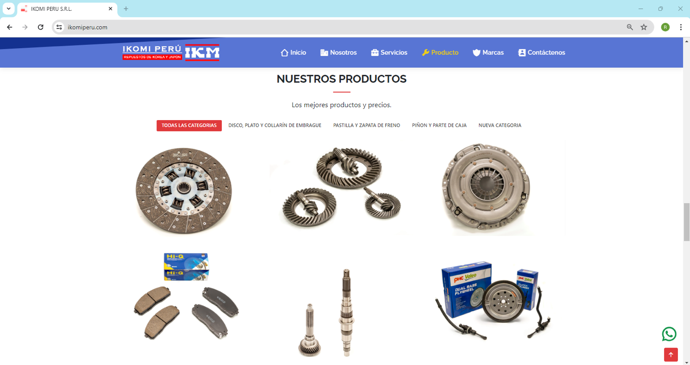
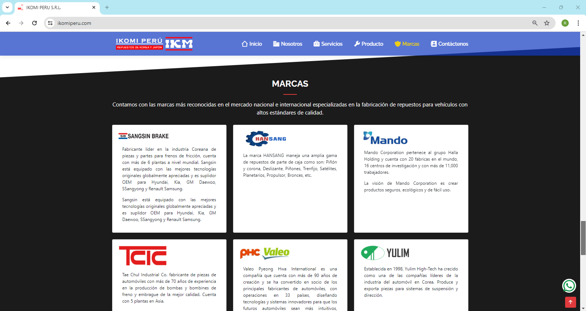
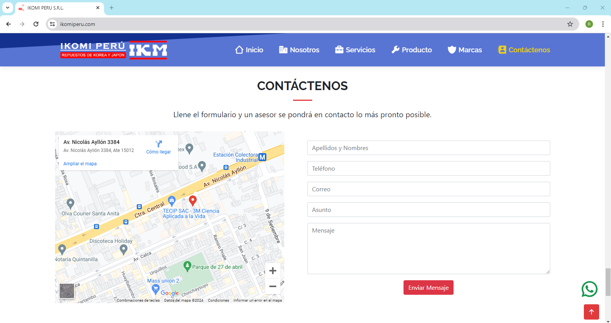
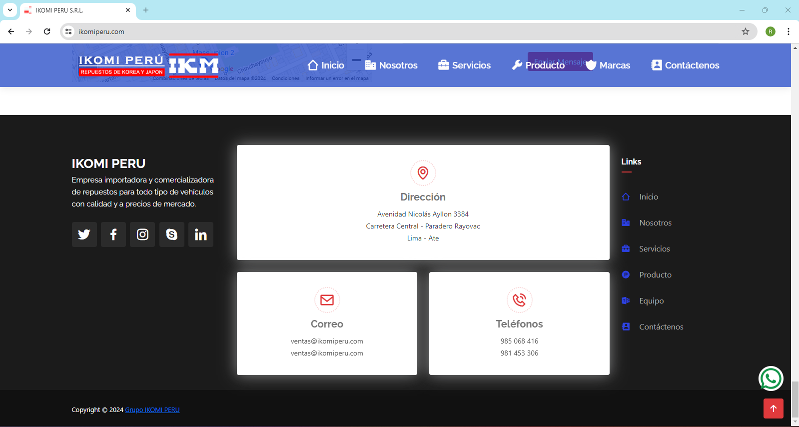

**EVALUACIÓN N°: 03**

> **04**
>
> **Desarrollo de aplicaciones Web Avanzado:** FullStack.

7.  **Procedimiento**

**Next.js: Introducción · Enrutamiento y Páginas · Componentes y
Estilización**

| ***Alumno(s):***                                                                                   |     |                        |                    |                              |                        | ***Nota*** |          |                       |
|----------------------------------------------------------------------------------------------------|-----|------------------------|--------------------|------------------------------|------------------------|------------|----------|-----------------------|
| ***Criterio de Evaluación***                                                                       |     | ***Excelente (4pts)*** | ***Bueno (3pts)*** | ***Requiere mejora (2pts)*** | ***No acept. (0pts)*** |            |          | ***Puntaje Logrado*** |
| 1\. Crea y configura un proyecto Next.js (App Router) y justifica sus decisiones de configuración. |     |                        |                    |                              |                        |            |          | ***4***               |
| 2\. Implementa el enrutamiento basado en archivos: páginas, layout, ruta dinámica y 404.           |     |                        |                    |                              |                        |            |          | ***4***               |
| 3\. Implementa la navegación con Link, enlace activo y menú responsive.                            |     |                        |                    |                              |                        |            |          | ***4***               |
| 4\. Construye componentes reutilizables y aplica una estrategia de estilización justificada.       |     |                        |                    |                              |                        |            |          | ***4***               |
| 5\. Analiza críticamente el uso de IA (bitácora, errores detectados) y sustenta su código.         |     |                        |                    |                              |                        |            |          | ***4***               |
| ***Puntaje total***                                                                                |     |                        |                    |                              |                        |            | ***20*** |                       |

**CASO: SITIO WEB CORPORATIVO DE IKOMI PERÚ CON NEXT.JS**

Visite la siguiente página: **https://www.ikomiperu.com/** y replique su
sitio web con **Next.js (App Router)**. Las capturas del anexo son la
referencia visual. No se busca una copia pixel a pixel: se evalúa que el
sitio funcione, que esté bien organizado y, sobre todo, que usted
**entienda y pueda justificar** cada decisión que tomó.

**Reglas de uso de Inteligencia Artificial**

En esta evaluación **sí está permitido usar IA**. Lo que se califica no
es solo el código, sino su capacidad de analizar, decidir y justificar.
Por ello:

- Puede usar la IA para generar, explicar o depurar código, pero **usted
  es responsable de todo lo que entrega**.

- Registre cada interacción relevante en BITACORA_IA.md (ver Parte 5).
  Si no hay bitácora, el criterio 5 se califica con 0.

- Las justificaciones deben estar escritas **con sus propias palabras**
  y referirse a **este proyecto**. Respuestas genéricas o copiadas de la
  IA no suman puntos.

- En la sustentación el docente podrá pedirle que explique o modifique
  en vivo cualquier archivo. **Si no puede explicar un fragmento de su
  código, el criterio relacionado se califica como máximo con 2
  puntos.**

- La IA suele proponer código desactualizado o del Pages Router.
  Detectarlo y corregirlo es parte de la evaluación.

**Parte 1 – Introducción a Next.js (Criterio 1: 4 pts)**

**1.1** Cree el proyecto y nómbrelo ikomi-next-\<apellido\>. Durante la
creación **usted debe decidir**: TypeScript o JavaScript, uso de
Tailwind CSS, uso de la carpeta src/, App Router y ESLint.

**1.2** En el archivo DECISIONES.md registre cada decisión en una tabla
con las columnas: **Opción elegida \| Alternativa descartada \|
Justificación** (mínimo dos líneas por decisión, relacionadas con el
sitio de IKOMI).

**1.3** Explique con sus palabras la función de: app/layout, app/page,
la carpeta public/, next.config y los scripts dev, build y start del
package.json.

**1.4** Responda: ¿qué ventaja concreta ofrece Next.js frente a una SPA
de React (por ejemplo con Vite) para un sitio corporativo como IKOMI?
Considere SEO, renderizado en el servidor y rendimiento. Dé al menos un
ejemplo aplicado a una página del sitio.

**1.5** Verifique que npm run build finaliza sin errores y adjunte la
captura en la carpeta evidencias/.

**Parte 2 – Enrutamiento y Páginas (Criterio 2: 4 pts)**

**2.1** Implemente las siguientes rutas usando el enrutamiento basado en
archivos del App Router:

| **Página de referencia** | **Ruta (URL)**             | **Archivo sugerido (.tsx o .jsx)** |
|--------------------------|----------------------------|------------------------------------|
| **Inicio**               | /                          | app/page.tsx                       |
| **Nosotros**             | /nosotros                  | app/nosotros/page.tsx              |
| **Servicios**            | /servicios                 | app/servicios/page.tsx             |
| **Productos**            | /productos                 | app/productos/page.tsx             |
| **Detalle de producto**  | /productos/\[slug\]        | app/productos/\[slug\]/page.tsx    |
| **Marcas**               | /marcas                    | app/marcas/page.tsx                |
| **Contáctenos**          | /contacto                  | app/contacto/page.tsx              |
| **Página no encontrada** | cualquier ruta inexistente | app/not-found.tsx                  |

**2.2 Ruta dinámica:** cree un archivo de datos (por ejemplo
data/productos.ts) con al menos 3 productos. La página /productos debe
listarlos y /productos/\[slug\] debe mostrar el detalle de cada uno. Si
el slug no existe, use notFound().

**2.3** Defina metadata (o generateMetadata en la ruta dinámica) para
que cada página tenga su propio título y descripción.

**2.4 Decisión justificada:** ¿usaría un layout anidado para /productos?
¿Agruparía rutas con route groups, por ejemplo (marketing)? Decida y
justifique en DECISIONES.md. Decidir **no** usarlos también es válido si
lo argumenta.

**Parte 3 – Navegación (Criterio 3: 4 pts)**

**3.1** Cree una barra de navegación usando el componente Link de
next/link, presente en todas las páginas.

**3.2** Resalte el enlace de la página actual usando usePathname.
Explique en DECISIONES.md **por qué** este componente debe ser un Client
Component ("use client") y por qué el resto del sitio puede quedarse
como Server Components.

**3.3** Implemente un menú responsive (por ejemplo, menú hamburguesa en
pantallas pequeñas).

**3.4 Experimento:** reemplace temporalmente un Link por una etiqueta
\<a href\>. Observe la pestaña Network de las DevTools al navegar y
describa con evidencia (captura) qué cambia y por qué.

**Parte 4 – Componentes y Estilización (Criterio 4: 4 pts)**

**4.1** Construya como mínimo estos componentes reutilizables: Navbar,
Footer, Hero (banner), ProductCard (recibe datos por props),
SectionTitle y ContactForm (solo interfaz). Navbar y Footer deben
ubicarse en el layout raíz.

**4.2 Estrategia de estilos:** elija entre Tailwind CSS, CSS Modules o
Bootstrap. Justifique su elección frente a las otras dos y mantenga un
criterio coherente (colores y tipografía definidos una sola vez, por
ejemplo con variables CSS o la configuración del tema).

**4.3** Use next/image para las imágenes (con alt descriptivo y tamaños
definidos) y next/font para la tipografía. Explique qué beneficio aporta
cada uno.

**4.4** El sitio debe verse correctamente en tres anchos: **375 px, 768
px y 1280 px**. Adjunte capturas de al menos dos páginas en cada ancho.

**4.5** Incluya al menos una animación o transición con propósito (por
ejemplo, hover en las tarjetas de producto o un carrusel de marcas) y
explique por qué mejora la experiencia del usuario.

**4.6** Dibuje el **árbol de componentes** del sitio (puede ser una
imagen o un diagrama en el README) indicando cuáles son Server
Components y cuáles Client Components.

**Parte 5 – Análisis crítico del uso de IA y sustentación (Criterio 5: 4
pts)**

**5.1** Elabore BITACORA_IA.md con **mínimo 5 entradas**. Cada entrada
debe incluir: objetivo, prompt utilizado, resumen de la respuesta,
decisión tomada (**aceptado / modificado / rechazado**) y justificación.

**5.2** Documente **al menos 2 casos** en que la IA propuso código
incorrecto, desactualizado o poco adecuado (por ejemplo: getStaticProps
o next/router dentro del App Router, \ en lugar de next/image,
falta de "use client", estilos duplicados). Muestre el antes y el
después y explique la corrección.

**5.3** Escriba una reflexión (máximo 200 palabras): ¿qué parte del
proyecto entiende mejor gracias a la IA y qué parte tuvo que razonar por
su cuenta porque la IA no la resolvió bien?

**5.4 Sustentación (5 min):** sin usar IA, deberá explicar su proyecto y
realizar un cambio pequeño en vivo indicado por el docente (por ejemplo:
agregar la ruta /blog, añadir una prop a ProductCard o cambiar el color
principal del tema).

**Entregables**

- Enlace al repositorio de GitHub con **commits progresivos** (mínimo 5,
  con mensajes descriptivos). Un único commit con todo el proyecto se
  considera falta de evidencia de proceso.

- Desplegar el app en alguna plataforma explicada en clase.

- README.md con los pasos para instalar y ejecutar el proyecto, y el
  árbol de componentes.

- DECISIONES.md y BITACORA_IA.md en la raíz del repositorio.

- Carpeta evidencias/ con las capturas solicitadas (build, Network,
  responsive).

- El proyecto debe ejecutarse con npm install y npm run dev, y compilar
  con npm run build sin errores.

**Rúbrica detallada (puntaje total: 20)**

| **Criterio**                                          | **Excelente (4 pts)**                                                                                                                                                                                          | **Bueno (3 pts)**                                                                            | **Requiere mejora (2 pts)**                                                               | **No aceptable (0 pts)**                                                          |
|-------------------------------------------------------|----------------------------------------------------------------------------------------------------------------------------------------------------------------------------------------------------------------|----------------------------------------------------------------------------------------------|-------------------------------------------------------------------------------------------|-----------------------------------------------------------------------------------|
| **1. Proyecto Next.js y decisiones de configuración** | El proyecto ejecuta y compila sin errores. Todas las decisiones están justificadas con argumentos propios vinculados al proyecto. Explica con precisión la estructura y la ventaja frente a una SPA.           | El proyecto funciona. Las justificaciones son correctas pero genéricas o falta una de ellas. | Funciona con errores o el build falla. Justificaciones superficiales o copiadas de la IA. | No crea el proyecto o no presenta justificaciones.                                |
| **2. Enrutamiento y páginas**                         | Todas las rutas funcionan, incluida la dinámica con datos y notFound(). 404 personalizada, metadata por página y decisión sobre layouts/route groups justificada.                                              | Rutas estáticas y dinámica funcionan; falta la 404, la metadata o la justificación.          | Solo rutas estáticas; la ruta dinámica no funciona.                                       | Menos de 4 rutas funcionales o no usa enrutamiento basado en archivos.            |
| **3. Navegación**                                     | Usa Link en todo el sitio, resalta el enlace activo y el menú es responsive. Explica Client vs Server Component y la diferencia Link vs \<a\> con evidencia.                                                   | Navegación completa con enlace activo; la explicación es incompleta.                         | Navegación funcional sin enlace activo o no responsive; sin explicación.                  | Navegación incompleta o con recargas completas en todo el sitio.                  |
| **4. Componentes y estilización**                     | Componentes reutilizables con props, Navbar/Footer en el layout, next/image y next/font, responsive en 3 anchos, animación con propósito, estrategia de estilos coherente y justificada, árbol de componentes. | Componentes y estilos correctos; falla en uno de: responsive, next/image o justificación.    | Poca reutilización (código duplicado) o estilos inconsistentes.                           | Todo en pocos archivos sin componentes o el sitio no corresponde a la referencia. |
| **5. Uso crítico de IA y sustentación**               | Bitácora con 5+ entradas y decisiones justificadas; 2+ errores de la IA detectados y corregidos; reflexión propia. Explica cualquier archivo y realiza el cambio en vivo.                                      | Bitácora completa y 1 error detectado. Sustenta con dudas menores.                           | Bitácora incompleta o genérica; no detecta errores. Le cuesta explicar su código.         | Sin bitácora o no puede explicar el código entregado.                             |

**Nota:** si el estudiante no puede explicar un fragmento de su código
durante la sustentación, el criterio relacionado se califica como máximo
con 2 puntos, aunque el código funcione.

**Anexo – Páginas de referencia a replicar**

**Página Inicio — ruta /**

**Página Nosotros — ruta /nosotros**

**Página Servicios — ruta /servicios**

**Página Productos — rutas /productos y /productos/\[slug\]**

**Página Marcas — ruta /marcas**

**Página Contáctenos — ruta /contacto**

**Pie de página — componente Footer en el layout raíz**

8.  **Conclusiones:**

Indicar 5 conclusiones que llegó después de la evaluación:

| N° | Conclusión Técnica |
|:---|:---|
| 1 | **Rendimiento y SEO optimizado con Server Components:** La arquitectura App Router de Next.js demostró ser superior a una SPA clásica con React/Vite para sitios corporativos como IKOMI Perú, ya que entrega HTML pre-renderizado desde el servidor, permitiendo una indexación inmediata de autopartes por código OEM en motores de búsqueda y tiempos de carga inicial casi instantáneos en redes móviles. |
| 2 | **Separación deliberada entre Server y Client Components:** El principio de mantener componentes visuales como Server Components y limitar la directiva `"use client"` a elementos estrictamente interactivos (como el `Navbar` para `usePathname`, el menú responsive y el `ContactForm`) minimiza el envío de JavaScript al navegador, protegiendo las métricas Web Vitals. |
| 3 | **Enrutamiento dinámico robusto y manejo de errores 404:** La implementación de rutas dinámicas `/productos/[slug]` complementada con `generateStaticParams()` para pre-renderizado SSG y la función `notFound()` garantiza una experiencia de usuario sólida frente a URLs inexistentes, protegiendo la integridad del catálogo de productos y guiando al usuario con una vista 404 personalizada. |
| 4 | **Consistencia y diseño responsivo con Tailwind CSS:** El uso de Tailwind CSS con una paleta de colores y variables institucionales centralizadas permitió replicar con fidelidad la estética corporativa de IKOMI (azul, rojo, fondo industrial), logrando un diseño responsivo fluido y adaptable a resoluciones móviles (375 px), tablets (768 px) y pantallas de escritorio (1280 px). |
| 5 | **Uso reflexivo y supervisión crítica de la Inteligencia Artificial:** Si bien la IA agiliza la generación de interfaces repetitivas y estructuras de datos, frecuentemente introduce código desactualizado del Pages Router (`useRouter` de `next/router`, `getStaticProps`, etiquetas `` no optimizadas). Es indispensable el criterio técnico y la validación continua del desarrollador para refactorizar y garantizar código moderno y seguro. |

